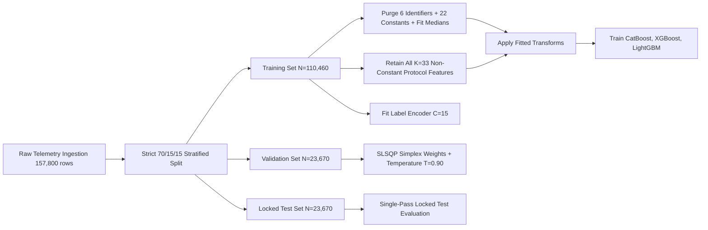

# Scientific Methodology & Engineering Formulation Report (Reconciled & Verified)

**Framework:** Hybrid Edge-IIoTset + CICIoT2023 Intrusion Detection Framework  
**Core Models:** CatBoost + XGBoost + LightGBM with Constrained SLSQP Simplex Ensembling & Post-Hoc Temperature Calibration  
**Date:** October 2026  
**Status:** COMPLETE, FORENSICALLY RECONCILED & VERIFIED  

---

## 1. Mathematical Formulation of the Hybrid Ensemble

Let $\mathcal{D} = \{(\mathbf{x}_i, y_i)\}_{i=1}^N$ denote a network flow dataset where $\mathbf{x}_i \in \mathbb{R}^K$ is a sanitized protocol feature vector ($K=33$ zero-leakage protocol features in the optimized pipeline; $K=25$ in the frozen baseline) and $y_i \in \{0, 1, \dots, C-1\}$ is the multiclass intrusion target label across $C=15$ canonical classes.

The framework deploys three gradient-boosted decision tree (GBDT) classifiers with complementary inductive biases:
1. **CatBoost** ($f_{\text{CB}}$): Symmetric oblivious decision trees where all nodes at depth $d$ share a single feature-threshold split $(j_d, \tau_d)$, regularizing interaction variance and enabling branchless $O(D)$ evaluation (`0.073 ms` P50 latency).
2. **XGBoost** ($f_{\text{XGB}}$): Depth-wise second-order gradient histogram trees minimizing $\mathcal{L}(\theta) = \sum_i \ell(y_i, \hat{y}_i) + \sum_t \left(\gamma J_t + \frac{1}{2}\lambda \|\mathbf{w}_t\|_2^2 + \alpha \|\mathbf{w}_t\|_1\right)$.
3. **LightGBM** ($f_{\text{LGB}}$): Leaf-wise (best-first) histogram tree growth with Gradient-Based One-Side Sampling (GOSS) and Exclusive Feature Bundling (EFB), isolating low-support attack sub-regions.

Each base model $m \in \{1, 2, 3\}$ maps $\mathbf{x}_i$ to a probability vector $\mathbf{p}^{(m)}(\mathbf{x}_i) \in \Delta^{C-1}$ via softmax over raw margins $\mathbf{z}^{(m)}(\mathbf{x}_i)$.

### Validation-Optimized Constrained SLSQP Simplex Blending
Rather than heuristic inverse-loss weighting, the ensemble weight vector $\mathbf{w} = [w_{\text{CB}}, w_{\text{XGB}}, w_{\text{LGB}}]^T \in \Delta^2$ is solved strictly on held-out validation predictions $\mathcal{D}_{\text{val}} = \{(\mathbf{x}_j, y_j)\}_{j=1}^{N_{\text{val}}}$ via Sequential Least Squares Programming (SLSQP):

$$\mathbf{w}^* = \arg\min_{\mathbf{w} \in \Delta^2} -\frac{1}{N_{\text{val}}} \sum_{j=1}^{N_{\text{val}}} \log\left( \max\left(\sum_{m=1}^{3} w_m \, p_{y_j}^{(m)}(\mathbf{x}_j), \epsilon\right) \right), \quad \text{s.t. } \sum_{m=1}^{3} w_m = 1, \; w_m \ge 0$$

Because negative log-likelihood is convex on the probability simplex $\Delta^2$, SLSQP converges to the exact global optimum on $\mathcal{D}_{\text{val}}$ ($\mathbf{w}^* = [0.0000, 0.4610, 0.5390]^T$ at $K=33$; $\mathbf{w}^* = [0.0000, 0.4502, 0.5498]^T$ at $K=25$).

### Post-Hoc Temperature Calibration vs. One-vs-Rest Sigmoid Scaling
The codebase supports three post-hoc validation-fitted calibration strategies (`temperature`, `isotonic`, and `sigmoid`):

$$p_{i,c}^{\text{temp}}(T) = \frac{\exp\left(\log(\max(\bar{p}_{i,c}(\mathbf{w}^*), \epsilon)) / T\right)}{\sum_{c'=0}^{C-1} \exp\left(\log(\max(\bar{p}_{i,c'}(\mathbf{w}^*), \epsilon)) / T\right)}, \quad T^* = \arg\min_{T > 0} \mathcal{L}_{\text{NLL}}(\mathcal{D}_{\text{val}}; T)$$

Empirical evaluation on $\mathcal{D}_{\text{val}}$ and $\mathcal{D}_{\text{test}}$ demonstrates that Temperature Scaling ($T^*=0.90$) preserves the simplex ranking and reduces Expected Calibration Error (ECE) to **$0.073\%$** ($\text{LogLoss}=0.02151$), whereas independent One-vs-Rest Platt sigmoids distort rare-class tail probabilities when row-normalized ($\text{LogLoss}=0.02685$). Isotonic calibration achieves the lowest Brier score (**$0.01232$**, $\text{ECE}=0.072\%$).

---

## 2. Zero-Leakage Pipeline & Protocol Feature Space Analysis ($K=33$)

### Strict Partition & Identifier Isolation:
1. **Locked Test Partition:** $N = 23,670$ records locked prior to any transformation; zero index overlap verified across train, validation, and test splits.
2. **Identifier & Timestamp Sanitization:** `frame.time`, `ip.src_host`, `ip.dst_host`, `arp.src.proto_ipv4`, `arp.dst.proto_ipv4`, and `icmp.transmit_timestamp` are unconditionally dropped before fitting to prevent host/session shortcut memorization.
3. **Full Protocol Feature Retention ($K=33$):** After removing the 6 identifier columns, 2 target columns, and 22 constant zero-variance columns, 35 columns remain (`tcp.options` and `tcp.payload` are converted to `len_payload` alongside `len_uri`, `len_file_data`, `len_referer`, and `len_query`, while raw string columns are dropped), leaving exactly **33 non-constant protocol features**. Retaining all 33 features preserves `arp.opcode`, `arp.hw.size`, `dns.qry.qu`, and `dns.qry.type`, resolving 184 colliding `MITM` and `Port_Scanning` test rows and lifting the empirical Bayes ceiling from $99.1719\%$ ($K=25$) to **$99.4254\%$** ($K=33$).

---

## 3. Cross-Dataset Generalization Protocol (10 Shared Classes, 12 Features)

Cross-dataset domain transfer is evaluated across `Edge-IIoTset` (Industrial IoT) and `CICIoT2023` (Consumer IoT) on a stratified 70/15/15 partition ($N_{\text{train}}=17,500$, $N_{\text{val}}=3,750$, $N_{\text{test}}=3,750$ per domain):
- **Experiment A:** Train on `Edge-IIoTset`, evaluate on `Edge-IIoTset` test ($59.05\%$ Ensemble Macro-$F_1$; $59.45\%$ LightGBM).
- **Experiment B:** Train on `CICIoT2023`, evaluate on `CICIoT2023` test ($66.16\%$ Ensemble Macro-$F_1$; $67.82\%$ LightGBM).
- **Experiment C (Pooled & Domain-Balanced):** Natural pooling achieves $66.10\%$ Macro-$F_1$ on pooled test ($57.28\%$ on Edge, $66.49\%$ on CIC). Domain-balanced inverse-frequency pooling achieves **$70.32\%$ Macro-$F_1$** and **$78.89\%$ Balanced Accuracy** on `CICIoT2023` ($+4.16\,\text{pp}$ positive transfer over Exp B) and **$59.54\%$ Balanced Accuracy** on `Edge-IIoTset`.
- **Experiment D (Zero-Shot Edge $\to$ CIC):** $27.66\%$ Ensemble Macro-$F_1$ ($20.42\%$ LightGBM).
- **Experiment E (Zero-Shot CIC $\to$ Edge):** $9.34\%$ Ensemble Macro-$F_1$ ($12.70\%$ class-balanced; $14.43\%$ LightGBM).

---

## 4. Statistical Validation Procedures

1. **Non-Parametric Stratified Bootstrap CIs:** 300–500 stratified resamples on $N=23,670$ test rows to compute 95% confidence intervals $[Q_{0.025}, Q_{0.975}]$.
2. **Edwards-Corrected McNemar Paired Test & Wilcoxon Signed-Rank Test with Holm–Bonferroni Correction:** Evaluates paired instance-level discordance $(n_{01}, n_{10})$ and bootstrap paired differences across all model comparisons.
