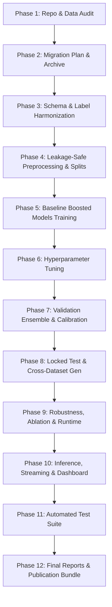

# System Architecture Migration Plan: Gradient Boosted Hybrid IDS

**Project:** Hybrid Edge-IIoTset + CICIoT2023 Intrusion Detection Framework  
**Target Architecture:** CatBoost + XGBoost + LightGBM with Validation-Based Hybrid Ensembling  
**Date:** October 2026  
**Document Status:** ACTIVE & APPROVED  

---

## 1. Migration Overview & Strategic Goals

The objective of this migration is to transition the intrusion detection pipeline from an obsolete, compute-heavy deep-learning architecture (1D-CNN + Ghost Modules + BiGRU + Temporal Attention + Early Exit) to an ultra-fast, robust, and mathematically sound gradient-boosted ensemble:

$$\hat{y}_{\text{ensemble}} = \arg\max_{c \in \mathcal{C}} \sum_{m \in \{\text{CatBoost}, \text{XGBoost}, \text{LightGBM}\}} w_m \cdot P_m(y = c \mid \mathbf{x})$$

where weights $w_m$ (or meta-classifier stacking weights) are rigorously fitted on out-of-fold validation probabilities, never touching locked test data.

---

## 2. Phased Transition Milestones



### Milestone Details
- **Phase 1 (Completed):** Complete forensic audit of repository, dependencies, memory limits, and SHA-256 dataset verification.
- **Phase 2 (Current):** Git checkpointing (`pre-migration-checkpoint`), migration manifest generation, and non-destructive archival of obsolete deep learning modules to `archive/legacy_dl_architecture/`.
- **Phase 3:** Canonical attack ontology creation (10 common attack families + 1 benign) mapping both Edge-IIoTset (15 classes) and CICIoT2023 (34 classes). Semantic feature harmonization mapping flow duration, packet rates, TCP flags, and protocol indicators.
- **Phase 4:** Leakage-safe, stratified train/val/test splitting (70/15/15) with strict isolation of locked test partitions. Feature cleaning, categorical handling, and zero-leakage training-fitted preprocessing.
- **Phase 5 & 6:** Implementation and training of CatBoost, XGBoost, and LightGBM models with early stopping on validation partitions and randomized hyperparameter search.
- **Phase 7:** Construction of validation-optimized hybrid ensembling:
  - Uniform probability averaging
  - Validation-loss-optimized weighted probability blending
  - Regularized stacking meta-classifier (Logistic Regression / Ridge) trained on out-of-fold predictions
  - Platt / Isotonic probability calibration
- **Phase 8:** Comprehensive locked test evaluation and mandatory cross-dataset generalization experiments (A: Edge->Edge, B: CIC->CIC, C: Harmonized Pooled, D: Edge->CIC, E: CIC->Edge).
- **Phase 9:** Robustness perturbations (Gaussian noise, feature dropout, domain shift) and microsecond-level latency benchmarks.
- **Phase 10:** Production-grade inference API, offline and live streaming Kafka/Redpanda adapter, and refreshed Streamlit SOC dashboard.
- **Phase 11 & 12:** Comprehensive test suite execution, reproducibility audit, and publication deliverables.

---

## 3. Directory Reorganization Blueprint

The existing root-level scattered scripts will be organized into the standard modular production package `src/hybrid_ids`:

```
project/
├── configs/
│   ├── data.yaml
│   ├── models.yaml
│   ├── ensemble.yaml
│   └── streaming.yaml
├── data/
│   ├── raw/
│   │   ├── edge_iiot/
│   │   └── cic_iot_2023/
│   ├── interim/
│   ├── processed/
│   └── manifests/
├── src/
│   └── hybrid_ids/
│       ├── config.py
│       ├── logging_config.py
│       ├── data/
│       │   ├── loaders.py
│       │   ├── schema_audit.py
│       │   ├── harmonization.py
│       │   ├── label_mapping.py
│       │   ├── validation.py
│       │   └── splitting.py
│       ├── preprocessing/
│       │   ├── cleaning.py
│       │   ├── encoding.py
│       │   ├── feature_engineering.py
│       │   └── feature_selection.py
│       ├── models/
│       │   ├── catboost_model.py
│       │   ├── xgboost_model.py
│       │   ├── lightgbm_model.py
│       │   ├── ensemble.py
│       │   └── calibration.py
│       ├── training/
│       │   ├── train_base_models.py
│       │   ├── train_ensemble.py
│       │   └── experiment_tracker.py
│       ├── evaluation/
│       │   ├── metrics.py
│       │   ├── statistical_tests.py
│       │   ├── robustness.py
│       │   └── cross_dataset.py
│       ├── inference/
│       │   ├── predictor.py
│       │   ├── batch_inference.py
│       │   └── model_registry.py
│       ├── streaming/
│       │   ├── producer.py
│       │   ├── consumer.py
│       │   ├── feature_adapter.py
│       │   └── alerting.py
│       └── utils/
│           ├── hashing.py
│           ├── reproducibility.py
│           └── resource_monitor.py
├── scripts/
│   ├── inspect_datasets.py
│   ├── prepare_data.py
│   ├── train_models.py
│   ├── evaluate_models.py
│   ├── run_inference.py
│   └── benchmark_runtime.py
└── tests/
```

---

## 4. Preservation & Non-Destructive Archival Protocol

1. **Raw Datasets:** Protected under immutable access. No script shall write to `data/raw/` or modify zip archives.
2. **Prior Experiment Evidence:** Reports in `reports/` (`REPRODUCIBILITY_REPORT.md`, `RESULT_RECONCILIATION.md`, `ABLATION_VALIDATION_REPORT.md`) and data in `reproducibility/` remain preserved to serve as historical baselines.
3. **Legacy Deep Learning Code:** All legacy neural network modules (`models/proposed_model.py`, `models/ghost_module.py`, `models/se_attention.py`, `models/bigru.py`, `models/temporal_attention.py`, `models/low_rank.py`, `training/trainer.py`, `training/losses.py`) are archived to `archive/legacy_dl_architecture/`.
